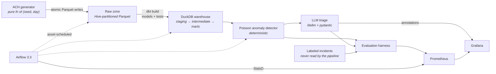

# ACH Data Platform

An end-to-end batch data platform for ACH payment operations: orchestration,
lakehouse modelling, monitoring, and an anomaly-detection layer whose quality
is measured rather than asserted.

**Airflow 3.3** (asset-scheduled) · **dbt** on **DuckDB + Parquet** ·
**Prometheus + Grafana** · **Docker** · **GitHub Actions** · **Terraform** ·
**litellm** for provider-agnostic LLM triage

The domain is real and public — NACHA return reason codes, SEC codes,
transaction codes, and the network's 60-day return-rate thresholds. The data is
synthetic, seeded and reproducible. No employer, merchant or vendor detail
appears anywhere in this repository.

---

## The problem it solves

An ODFI originating ACH debits has a compliance exposure that is easy to state
and hard to see coming. If an originator's rolling 60-day unauthorized return
rate crosses 0.5%, or its administrative return rate crosses 3%, the network
comes asking. By the time a monthly report shows it, the damage is weeks old.

The platform ingests daily ACH activity, models it into return-rate and
settlement marts, watches every originator against its own recent history, and
produces a triaged, human-readable explanation of anything that looks wrong —
with a measurement of how often that explanation is correct.

## Architecture



Three DAGs joined by assets, not by staggered cron:

```
ach_ingest  ──⬢ ach_raw_daily──▶  ach_transform  ──⬢ ach_marts──▶  ach_eval
@daily, catchup                   max_active_runs=1                 quality gate
```

**[docs/architecture.md](docs/architecture.md)** explains every layer and why it
is shaped that way. The decisions with real trade-offs are in
**[docs/adr/](docs/adr/)**.

## Results

The evaluation harness scores the detector and the triage step against a
labeled incident plan that the pipeline never sees. It runs as a pipeline stage
(`ach_eval`) on every refresh of the marts, and CI fails the build when any
number drops below the floor committed in
[`eval/thresholds.json`](eval/thresholds.json).

10 labeled incidents across 6 incident types, 24 originators, 60 days,
~181,000 entries. Seed 42.

<!-- eval:start -->
10 labeled incidents, history through 2026-08-31, alpha=0.001, return window 14 days.

| Measure | Value | What it means |
| --- | --- | --- |
| Incident recall | **0.90 (9/10)** | Labeled incidents with at least one flagged day |
| Cluster precision | **0.82 (9/11)** | Flagged clusters that overlap a real incident |
| Day-level precision | **0.89** | Flagged originator-days that are inside an incident |
| Day-level recall | **0.61** | Incident days the detector flagged |
| Day-level F1 | **0.72** | tp=17, fp=2, fn=11 |
| Mean detection delay | **0.22 days** | Incident start to first flag |
| Triage accuracy — rules baseline | **1.00 (n=9)** | Baseline, *given* the detector signal |
| Triage accuracy — LLM (`ollama_chat/qwen3:4b`) | **1.00 (n=3)** | Model, from the evidence packet alone |
| LLM — correctly called a false positive noise | **0.00 (0/0)** | What the rules baseline structurally cannot do |
| LLM calls with no usable result | **8** | Timeout or schema failure after one retry |

Recall by incident type: `admin_return_spike` 0.50, `duplicate_file` 1.00, `nsf_spike` 1.00, `settlement_delay` 1.00, `unauthorized_return_spike` 1.00, `volume_drop` 1.00
<!-- eval:end -->

Measured from the shipped dbt marts, not from a model of them: every figure
above comes from `data/runs/eval.json` after a real `dbt build`, and
`make crosscheck` confirms those marts agree column-for-column with an
independent pandas implementation. Regenerate the table with
`python scripts/eval_table.py` — the numbers are generated, not typed.

### Reading these numbers honestly

**Day-level recall of 0.61 is a deliberate trade, not a shortfall.** The
detector flags the *sharp* days of an incident rather than every day of it.
Loosening the significance threshold buys day-level recall back and costs
precision, and an alert nobody reads has a true recall of zero. What matters
operationally is whether the incident was caught at all — 9 of 10 — and how
soon: 0.22 days.

**The rules baseline scoring 1.00 is the point, not a victory.** It is a
six-line lookup from detector signal to incident type, and it is handed the
signal for free. It is the bar the model has to clear, and the model is
deliberately not told which signal fired (enforced by a test, not by intention).

**The rules baseline also has a weakness the number hides.** On the 2
false-positive clusters it answered "no_incident" 0 times — it *cannot*, since
a signal fired by definition. That is precisely where a model reading the raw
evidence can add something a lookup table never will, and the harness reports
`no_incident_rate_on_fp_clusters` separately so that capability is measurable
rather than assumed.

**The first version of the detector measured P=0.10.**
[ADR-0005](docs/adr/0005-poisson-surprise-over-z-score.md) is the whole story:
two real bugs, a statistic that was answering the wrong question, and a labeled
incident that was undetectable by construction.

## Quick start

```bash
# Local run — no containers, ~1 minute
make install
make pipeline          # land → dbt build → detect → triage → score
make verify            # lint, tests, mart cross-check, quality floors

# Full stack — Airflow + Prometheus + Grafana
make up                # http://localhost:8080 (Airflow), :3000 (Grafana)
make airflow-password  # the generated UI password
```

Then unpause `ach_ingest` in the Airflow UI. Catchup replays the synthetic
history one run per banking day, which is what makes the pipeline-health
dashboard worth looking at.

LLM triage defaults to a local Ollama model (`ollama_chat/qwen3:4b`) — free, no
rate limits, nothing leaves the machine. Point `TRIAGE_MODEL` at any provider
litellm supports to switch; see [`.env.example`](.env.example).

## What is in here

```
airflow/dags/        3 asset-scheduled DAGs; wiring only, no logic, no sibling imports
dbt/ach_dbt/         staging → intermediate → marts, 40+ tests, 2 macros
src/ach_platform/    generator, landing, validation, detector, triage, eval, metrics
monitoring/          statsd mapping, Prometheus scrape + alert rules,
                     provisioned Grafana datasource and 2 dashboards
infra/terraform/     Artifact Registry, GCS lake bucket, scoped service account
scripts/             quality gates: eval floors, mart cross-check, DAG parse
tests/               unit tests, an independent pandas reference implementation,
                     and a static contract test for the monitoring stack
docs/adr/            8 architecture decision records
```

### Things worth a look

**`src/ach_platform/generate.py`** — the generator is a pure function of
`(seed, day)`, which is what lets the ingest DAG be three lines with no
bookkeeping table. Returns arrive 1–10 banking days late, so a day's return
rate is only fully known after its window closes, and the detector refuses to
judge days that have not matured.

**`scripts/crosscheck_marts.py`** — dbt tests assert a table satisfies its
contracts; they cannot tell you the aggregation is *right*. A window frame off
by one row passes every one of them. So `fct_originator_daily` is computed a
second time in pandas from the generator's own output and compared row by row,
in CI. Two independent implementations agreeing is evidence; one implementation
passing its own tests is not.

It earned that on its first real run. Four columns disagreed, and the warehouse
was always *short*: the ingest looked back 16 calendar days for returns arriving
on a given day, but an unauthorized return on a Friday entry can arrive 17
calendar days after the effective date. Seven of 4,369 returns were generated
and never landed. Every partition was well-formed, all 46 dbt tests passed, and
the only symptom was a handful of originator-days reporting slightly lower
unauthorized return rates than the truth. `test_every_return_lands_exactly_once`
now pins the invariant.

**`monitoring/`** — Airflow's metrics answer *is the pipeline healthy*. They say
nothing about whether the data is. Rows landed, contract violations, dbt test
outcomes, return rates, NACHA breaches and the detector's own precision and
recall are pushed from the tasks to a Pushgateway, because a short-lived task
is not something Prometheus can scrape.

A Grafana panel querying a metric nothing emits does not fail — it renders
"No data", which looks exactly like a healthy system with nothing to report.
An alert rule with a typo is worse, because it can never fire and still looks
like coverage. `tests/test_monitoring_contract.py` closes both statically:
every metric a panel or rule queries must be one the code emits, every label
matcher and `{{legend}}` must reference a declared label, and the compose
mounts, scrape targets, rule-file paths and datasource UIDs must all resolve.
It needs no Docker, which is the point — the monitoring stack is the hardest
part of this project to exercise in CI, so it is checked without running it.

**`dbt/ach_dbt/macros/banking_days_between.sql`** — a Friday entry settling
Monday has a 1-day lag, not 3. Getting this wrong made every Friday look like
an incident.

## Verification

| Layer | How it is checked | Where |
| --- | --- | --- |
| Generator, detector, eval math | Unit tests, no warehouse needed | `make test` |
| Banking-day arithmetic | Closed form vs. brute force, every weekday × 30 lags | `tests/test_banking_days.py` |
| dbt models | 40+ schema, relationship and singular tests | `dbt build` |
| Mart correctness | Independent pandas implementation, row by row | `make crosscheck` |
| Detector quality | Precision / recall vs. labeled ground truth | `make eval` |
| Quality regressions | Committed floors, enforced on every PR | `scripts/check_eval.py` |
| DAG importability | Airflow's own `DagBag`, inside the built image | `make parse-dags` |
| Monitoring contract | Every queried metric is emitted; every emitted metric is charted; compose mounts, scrape targets and datasource UIDs resolve | `tests/test_monitoring_contract.py` |
| Infrastructure | `fmt -check`, `validate` | CI `terraform` job |

`terraform apply` has not been run against a real GCP project; only formatting
and validation are exercised. CD publishes a signed multi-arch image to GHCR
and stops there deliberately — see
[ADR-0006](docs/adr/0006-terraform-over-kubernetes.md).

## Notes

Built on Airflow 3.3.1 and its `airflow.sdk` Task SDK — assets, `@task.bash`,
and the standalone DAG processor — rather than Airflow 2 patterns. dbt is
pinned to 1.x in its own virtualenv inside the image
([ADR-0004](docs/adr/0004-dbt-in-its-own-virtualenv.md)); dbt Core v2, the
Rust/Fusion rewrite, was still in alpha when this was built.

## Licence

MIT.
