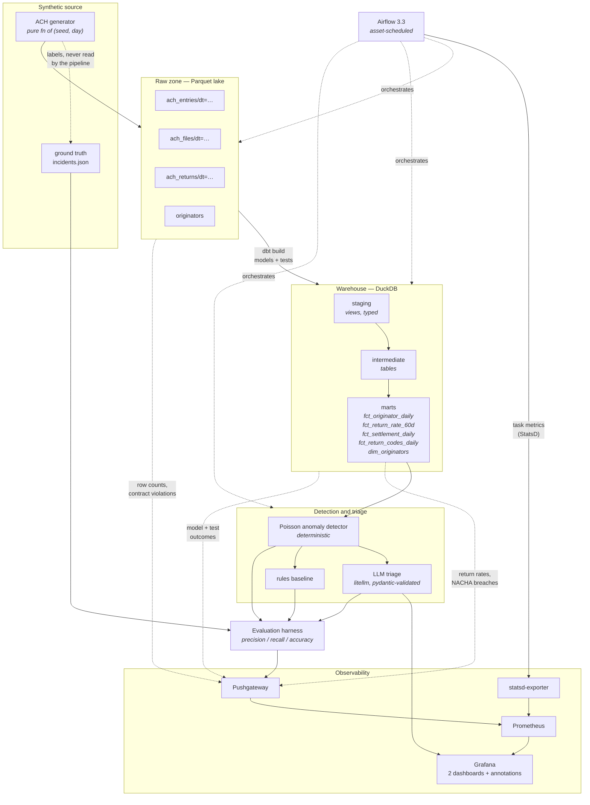
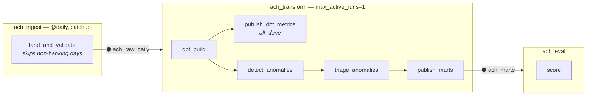

# Architecture

## The shape of the thing

## Orchestration: three DAGs joined by assets

Airflow 3 schedules DAGs on **assets**, not on a cron plus hope. `ach_transform`
does not run at 06:30 and trust that ingest finished; it runs when the raw
partition for a day exists and passed validation. The consequences are
concrete: a skipped weekend correctly stops the chain, a failed dbt test stops
the marts from being declared fresh, and the lineage drawn in the UI is the
real dependency graph rather than a diagram someone maintained by hand.

## Why each layer is the way it is

### Raw zone: Hive-partitioned Parquet, written atomically

One file per table per day, under `dt=YYYY-MM-DD/`. dbt reads it in place with
`read_parquet(..., hive_partitioning = true)` — nothing is copied into the
warehouse until the staging layer decides how to type it.

Every write goes to a temporary file in the same directory and is moved into
place with `os.replace`. A crashed task can therefore never leave a truncated
Parquet file that poisons every downstream glob, and the ingest DAG can run
several days concurrently during catchup without two tasks interleaving writes
to the shared originator dimension.

### The unit of work is one day, and it is idempotent

`land_day(seed, day)` is a pure function. Re-running a task, clearing a run,
or replaying a month rewrites byte-identical Parquet. That single property is
why the ingest DAG has no bookkeeping table, no "have I already processed
this?" check, and no partial-write cleanup. Reproducibility here is
deliberate engineering, not luck: no `uuid4()` (it ignores `random.seed()`),
no built-in `hash()` (randomised per process), and seeded RNG derived from
`(seed, day)` rather than from a shared global stream.

### Returns arrive late, and the models say so

A return for an entry originated on day *P* arrives 1–10 banking days later.
So the ingest for day *D* lands *the returns that arrive on D*, which belong to
earlier entries — but `int_originator_daily` attributes them back to the day
the entry was **originated**, because that is how a return rate is defined and
what makes a spike land on the day the bad file went out.

The cost of that choice is that recent days are under-counted until the return
window closes. Rather than hide it, the detector refuses to evaluate rate
signals on days younger than the window. A day whose returns have not all
arrived always looks healthier than it is, and a detector that does not know
that will report clean weeks forever.

### Staging → intermediate → marts

Staging is views (thin, typed, no business logic — re-reading the lake stays
cheap and lineage stays honest). Intermediate is tables (joins and aggregates
the marts would otherwise recompute). Marts are tables and are the only thing
the detector, the dashboards, or any BI tool reads.

Two things that look like details and are not:

**Settlement lag is measured in banking days.** A Friday entry settling Monday
is a 1-day lag, not 3. Measuring calendar days made every Friday look like a
settlement-delay incident — 160 of 233 false positives in the first measured
run. The closed-form `banking_days_between` macro is pinned by a test that
brute-forces it against a day-by-day count.

**Baselines come in two flavours.** `baseline_*_rate` is the mean of daily
rates (what a human reads on a chart); `baseline_*_sum` is pooled counts (what
the detector uses). A pooled rate over ~2,800 trailing entries is far more
stable than the mean of fourteen noisy daily rates. Both are computed in SQL so
the dashboard and the detector cannot disagree about what "normal" was.

### Detection: a Poisson surprise test, not a z-score

A 200-entry day has zero, one, or two unauthorized returns. One return is
already 0.5% — the NACHA threshold, which is defined over *60-day* windows, not
days. Against a near-zero trailing baseline, one extra return is a 5σ event, so
a z-score on daily rates flags noise all day long.

The test is instead: given today's entry count *n* and the pooled trailing rate
*p₀*, how surprising is *k* returns? Flag when `P(X ≥ k | λ = n·p₀) < α`, with
α = 10⁻³, a floor of 3 events, and Bayesian pseudo-counts so a quiet baseline
cannot drive λ to zero.

Six signals run per originator-day: three rate signals on that test, plus
volume drop (against the trailing baseline), duplicate submissions (the same
account, amount and effective date appearing twice — the signature of a file
sent twice), and settlement lag. Consecutive flagged days for one originator
cluster into one candidate incident.

Everything here is arithmetic on a mart: free, fast, reproducible, and
explainable. That matters because it sets up the next layer.

### Triage: the model has a baseline to beat

The LLM receives an evidence packet — the originator's context, the flagged
days' metrics against baseline, the return codes that arrived — and classifies
the incident, then writes the root-cause hypothesis and recommended action.

It is **not** told which detector signal fired. The rules baseline gets that
for free, which is exactly why it exists: a six-line lookup from dominant
signal to incident type is the bar. If the model cannot match a lookup table
while reading the raw numbers, the narrative it writes alongside its
classification is not trustworthy either, and the eval reports both side by
side so that is visible rather than assumed.

Output is validated against a pydantic schema and retried once with the
validation error in the prompt. There is deliberately **no confidence field**:
the previous project in this portfolio measured self-reported LM confidence at
0.71 when correct and 0.95 when incorrect — inverted — so collecting it would
only invite someone to act on it.

When the model is unreachable the triage task does not fail the DAG. The rules
baseline always produces a verdict, so an Ollama that is not running degrades
the output instead of reddening the pipeline. Failures are counted and
surfaced in the eval rather than swallowed.

### Evaluation is a pipeline stage, not a README claim

`ach_eval` runs on every refresh of the marts and scores three things against
the labeled incident plan the pipeline never sees: detection at day level
(precision / recall / F1), detection at incident level (recall, cluster
precision, mean detection delay), and triage accuracy for both methods.

Those numbers are pushed to the same Prometheus the operational metrics land
in, and CI fails the build when any of them drops below the floor committed in
`eval/thresholds.json`. A change that quietly costs twenty points of recall
shows up as a red build and a falling line on a dashboard, not as a surprise
months later.

### Observability: two questions, two dashboards

Airflow's own metrics answer *is the pipeline healthy* — scheduler heartbeat,
task outcomes, durations, queue time. They reach Prometheus over StatsD via
`statsd-exporter`, with DogStatsD tagging enabled so `dag_id` and `task_id`
arrive as labels instead of being baked into metric names.

They say nothing about whether the **data** is healthy. Those metrics — rows
landed, contract violations, dbt model and test outcomes, return rates, NACHA
breaches, detector quality — are pushed from the tasks themselves to a
Pushgateway, because a short-lived task is not something Prometheus can scrape.

The LLM's verdicts are posted as Grafana annotations on the exact days of the
anomaly, so the classification and hypothesis appear next to the metric that
triggered them. It is the cheapest useful surface for a model's output: no new
service, no new UI.

## What is deliberately not here

- **Kubernetes.** Running kind, Airflow and the monitoring stack together on a
  16 GB laptop buys a lot of YAML and no additional insight. The official
  Airflow Helm chart is the documented next step (ADR-0006).
- **CeleryExecutor.** LocalExecutor is honest about being one machine. Celery
  would add Redis, a worker and Flower to demonstrate a distributed model that
  is not actually distributed here. The executor is one environment variable.
- **An automatic deploy.** CD publishes a signed, multi-arch image to GHCR and
  stops. Terraform provisions the registry, bucket and least-privileged
  identity a Cloud Run deployment would target. A `gcloud run deploy` step that
  had never run against a real project would be a stub that looks like it works.
- **Great Expectations / Soda.** dbt tests plus a raw-contract check cover this
  schema, and the raw checks catch the class of problem that would otherwise
  become a confusing dbt compile error. Adding a third framework would be tool
  count, not coverage.
